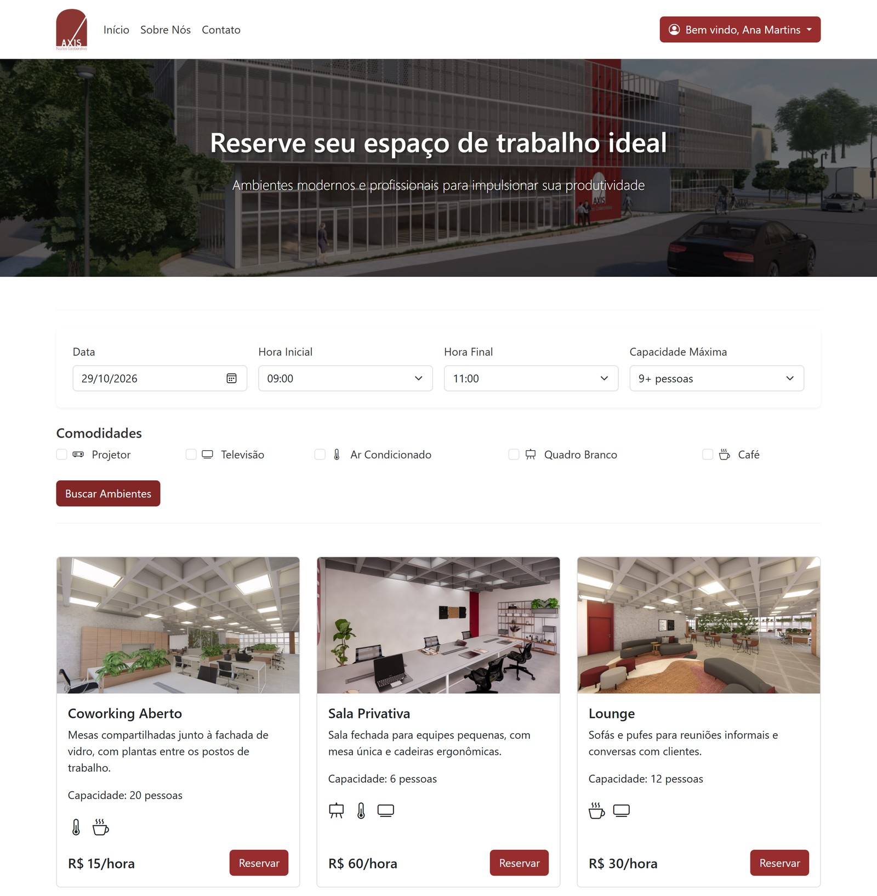
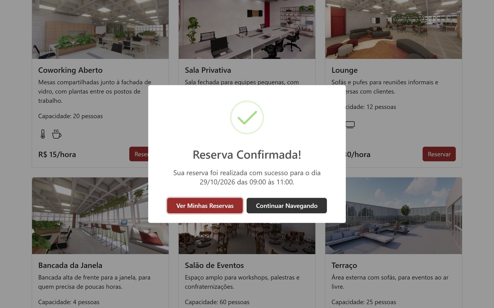
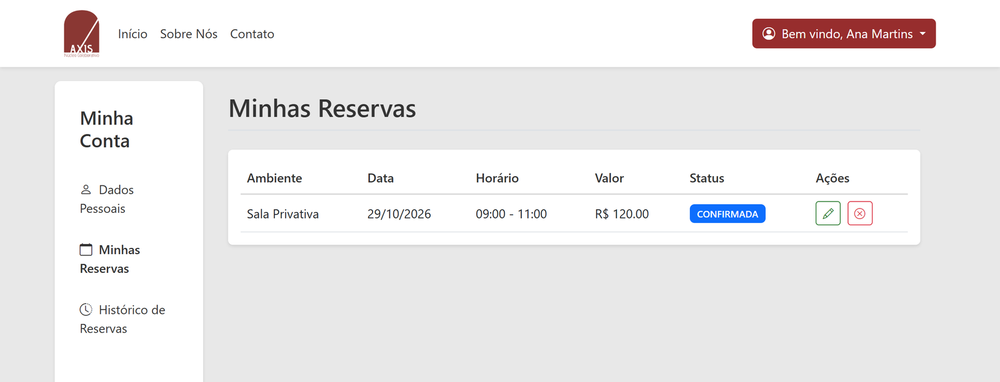
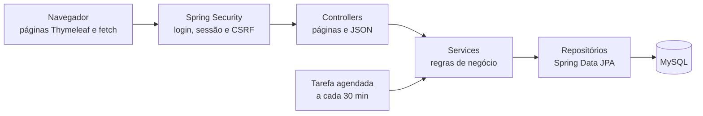

# Axis

[](https://github.com/vitor-brack/Axis/actions/workflows/ci.yml)



O Axis é um sistema web para reservar espaços num coworking. A pessoa escolhe a data, o horário, a capacidade e as comodidades, vê os ambientes livres no período e reserva. Na conta, ela acompanha, altera e cancela as próprias reservas.

## Por que existe

O Axis foi um trabalho da faculdade, feito no fim de 2024: o sistema de reservas de um coworking, o AXIS Núcleo Colaborativo. O código é meu; as imagens do prédio e dos ambientes são renders feitos por outra pessoa.

Em outubro de 2026, voltei ao projeto para uma revisão. Corrigi quatro bugs, cada um com um teste que falhava antes da correção, liguei a proteção contra CSRF e coloquei os testes para rodar no GitHub Actions. Os detalhes estão em [O que mudou na revisão de 2026](#o-que-mudou-na-revisão-de-2026).

## O que dá para fazer

- Buscar ambientes livres por data, horário, capacidade e comodidades, sem entrar na conta
- Criar uma conta e entrar. A senha é guardada com hash BCrypt
- Reservar um ambiente. O valor sai dos minutos reservados, e um horário que se sobrepõe a outra reserva do mesmo ambiente é recusado
- Ver, alterar e cancelar as próprias reservas e consultar o histórico
- Editar os dados pessoais

A cada 30 minutos, uma tarefa agendada marca como concluídas as reservas confirmadas cujo horário de início já passou.





## Stack

- Java 21 e Spring Boot 3.3, com Spring Web, Spring Data JPA (Hibernate) e Spring Security
- Thymeleaf nas páginas e JavaScript (`fetch`) na busca e nas ações de reserva, com Bootstrap 5 e SweetAlert2
- MySQL 8 na aplicação e H2 em memória nos testes
- Lombok
- JUnit 5, MockMvc e Spring Security Test
- Maven, com o wrapper (`mvnw`) no repositório
- GitHub Actions, que roda os testes a cada push na `main` e em cada pull request

## Como funciona



O Thymeleaf monta as páginas no servidor. A busca e as ações de reserva chamam endpoints JSON com `fetch`, e os POSTs levam o token CSRF num header, lido das metatags do layout. As regras de negócio ficam nos services, e as consultas de disponibilidade e de conflito de horário são JPQL nos repositórios.

| Classe | O que faz |
|---|---|
| `SecurityConfig` | Rotas públicas (início, cadastro, login e busca), login por formulário, CSRF e BCrypt |
| `AmbienteController` | `GET /ambiente/buscar`: os ambientes livres no período, em JSON |
| `ReservaController` | `POST /reserva/criar` e as consultas de reserva, em JSON |
| `UsuarioController` | Páginas de cadastro, login, dados pessoais, minhas reservas e histórico, incluindo alterar e cancelar |
| `ReservaService` | Conflito de horário, cálculo do valor, alteração, cancelamento e a tarefa agendada |
| `AmbienteRepository` e `ReservaRepository` | Consultas de disponibilidade e de reservas sobrepostas |
| `CPFValidator`, `EmailValidator`, `NomeValidator` e `TelefoneValidator` | Validação dos dados do cadastro |

## Como rodar

Precisa do JDK 21 e do Docker. Os comandos abaixo rodam na pasta do projeto.

1. Suba um MySQL 8 descartável:

   ```bash
   docker run -d --name axis-mysql -p 3306:3306 -e MYSQL_ROOT_PASSWORD=root -e MYSQL_DATABASE=axis mysql:8.4
   ```

2. Rode a aplicação e abra http://localhost:8080. Na primeira vez, o Hibernate cria as tabelas.

   ```bash
   ./mvnw spring-boot:run
   ```

   No PowerShell ou no cmd, use `.\mvnw.cmd spring-boot:run`.

3. Com a aplicação já iniciada uma vez, carregue os seis ambientes de demonstração. Sem eles a busca volta vazia, porque o Axis ainda não tem uma tela para cadastrar ambientes.

   ```bash
   docker cp docs/dados-demo.sql axis-mysql:/tmp/dados-demo.sql
   docker exec axis-mysql mysql -uroot -proot axis -e "source /tmp/dados-demo.sql"
   ```

Depois é só criar uma conta em **Cadastro** e reservar.

A conexão vem das variáveis `DB_URL`, `DB_USERNAME` e `DB_PASSWORD`. Sem elas, a aplicação usa o banco `axis` em `localhost:3306`, com usuário e senha `root`. Se a porta 3306 já estiver ocupada por outro MySQL, troque o `-p` do passo 1 por `-p 3307:3306` e aponte o `DB_URL` para a porta nova:

```bash
DB_URL=jdbc:mysql://localhost:3307/axis ./mvnw spring-boot:run
```

```powershell
$env:DB_URL = "jdbc:mysql://localhost:3307/axis"; .\mvnw.cmd spring-boot:run
```

Para os testes:

```bash
./mvnw test
```

Os 17 testes rodam num H2 em memória e não precisam do MySQL.

## O que mudou na revisão de 2026

Relendo o código, achei quatro bugs. Cada correção veio com um teste que falhava antes dela.

### 1. Reserva sem login

`/reserva/criar` estava liberada no `permitAll`, então um visitante chegava ao controller sem usuário logado e causava `NullPointerException`. Agora a rota exige login e o visitante vai para a tela de login. O `ReservaControllerTest` cobre o visitante e o usuário logado, com MockMvc e a configuração de segurança real.

### 2. Duas reservas no mesmo horário

`criarReserva` salvava sem procurar conflito, e duas pessoas podiam reservar o mesmo ambiente na mesma hora. Agora a criação usa a mesma consulta de sobreposição que a alteração já usava e responde 409. Os testes do `ReservaServiceTest` rodam o service e os repositórios reais sobre H2, porque a regra está na consulta.

### 3. Cancelar uma reserva cancelada

A checagem comparava a String `"CANCELADA"` com o enum `StatusReserva`, o que nunca dá igual, e uma reserva já cancelada podia ser cancelada de novo. Agora a comparação é com `StatusReserva.CANCELADA`.

### 4. Consultas pelo nome em vez do e-mail

As consultas de reserva filtravam pelo nome do usuário, mas recebiam o e-mail do login. Por isso `GET /reserva` voltava vazio e `GET /reserva/{id}` respondia 404. Agora elas filtram pelo e-mail.

### Outras mudanças

- O valor da reserva passava por `double` e não era arredondado: 50 minutos a R$ 50,00 a hora davam 41.66666666666667. Agora um único método calcula minutos × valor por hora ÷ 60 em `BigDecimal` e arredonda para centavos.
- O CSRF estava desligado, e outro site podia criar, alterar ou cancelar reservas pelo navegador de quem estivesse logado. Agora o layout expõe o token em metatags, os quatro POSTs feitos com `fetch` mandam o token num header e o `CsrfTest` confere que um POST sem token é recusado.
- A tarefa agendada lançava uma `ResponseStatusException`, que nenhuma requisição recebe, e perdia a causa do erro. Agora ela registra o erro no log, com a causa. Para isso, o método perdeu o `@Transactional`: com ele, a falha do UPDATE marcava a transação de fora para rollback, e o commit lançava `UnexpectedRollbackException` mesmo com o `catch`.
- As dependências passaram a ser injetadas pelo construtor, sem `@Autowired` em campo.
- Depois de uma reserva salva, a tela mostrava "Erro! dateFns is not defined", porque o endereço `date-fns@latest` do CDN passou a responder 404. A página agora carrega uma versão fixa do pacote `@date-fns/cdn`.
- O `mvn test` precisava do MySQL rodando. Agora todos os testes usam H2, e o GitHub Actions roda a suíte a cada push.

## Próximos passos

- Validar o horário de funcionamento e a data também na criação da reserva, que hoje só a alteração confere, e alinhar o horário: o back-end aceita das 7h às 19h, mas a tela oferece até as 23h
- Implementar o pagamento: a entidade `Pagamento` existe, mas nada a usa ainda
- Criar uma tela de administração para os ambientes, que hoje entram direto no banco
- Reescrever a consulta de disponibilidade sem o `COALESCE(:comodidades, NULL)`, que o H2 não aceita, para cobrir a busca com testes
- Mostrar os valores no formato brasileiro, como R$ 120,00

## Licença

[MIT](LICENSE)
